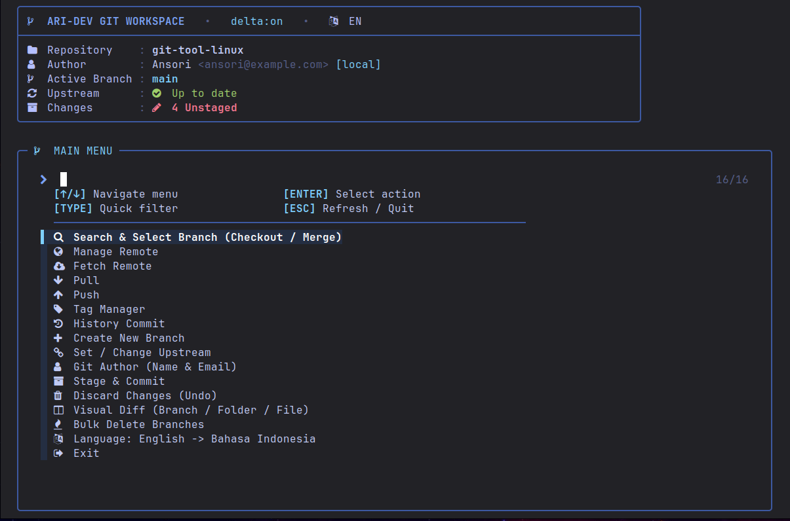

# ARI-DEV Interactive Git Workspace (`gt`)

An interactive, bilingual (English / Bahasa Indonesia), true-color Git TUI (Terminal User Interface) built with Bash and `fzf`, designed for speed, safety, and modern terminal aesthetics (Soft Blue theme with Nerd Font icons).

---

## 🎨 Preview & Screenshot



---

## Features

- **Interactive TUI with FZF**: Smooth searching, filtering, and previewing of branches, commits, tags, and remotes.
- **Bilingual Support**: Toggle instantly between **English** and **Bahasa Indonesia** (`--lang en|id` or via the TUI menu).
- **Workspace Dashboard**: Live status of active repository, author config, branch name, upstream sync status, and staged/unstaged changes counter.
- **Stage & Commit**: Interactive multi-file picker with diff previews, quick staging, commit messaging, and optional push.
- **Branch Management**: Checkout local/remote branches, create new branches with upstream tracking, and bulk delete local/remote branches safely.
- **Conflict Resolution**: Integrated support for merge conflict resolution tools (`Sublime Merge`, `IntelliJ IDEA`, `Meld`).
- **Visual Diffs**: Branch, folder, and file diffing using `meld` or `delta`.
- **Commit History**: Visual git log with local commit tags (`[L]`), insertions/deletions stats, diff inspection, and mixed/hard reset options.
- **Git Author Management**: Easily configure and toggle repository-local vs. global author names and emails.

---

## Prerequisites

Before running `gt`, ensure you have the following dependencies installed:

- **`git`**
- **`fzf`** (fuzzy finder)
- **`gawk`** (GNU Awk)
- **`meld`** (Visual diff & merge tool)
- A **Nerd Font** installed in your terminal emulator (e.g., *JetBrainsMono Nerd Font*) for icons to render correctly.

### Installing Dependencies on Ubuntu / Debian:
```bash
sudo apt update && sudo apt install -y git fzf gawk meld
```

---

## Installation

Clone the repository and run the interactive installer script:

```bash
git clone https://github.com/your-username/git-tool-linux.git
cd git-tool-linux
chmod +x install.sh
./install.sh
```

During installation, you can choose:
1. **Local User Installation (`~/.local/bin/gt`)**: No root/sudo access required. The installer will also check your `$PATH` and optionally update your `.bashrc` or `.zshrc`.
2. **Global System Installation (`/usr/local/bin/gt`)**: Requires `sudo` privileges to install globally for all system users.

---

## Usage

Once installed, simply navigate to any Git repository and run:

```bash
gt
```

### Command-Line Arguments

- Run in a specific language:
  ```bash
  gt --lang id   # Bahasa Indonesia
  gt --lang en   # English
  ```
- View help:
  ```bash
  gt --help
  ```

---

## License

This project is licensed under the MIT License. See the [LICENSE](LICENSE) file for details.

Generated with [Continue](https://continue.dev)  
Co-Authored-By: Continue <noreply@continue.dev>
